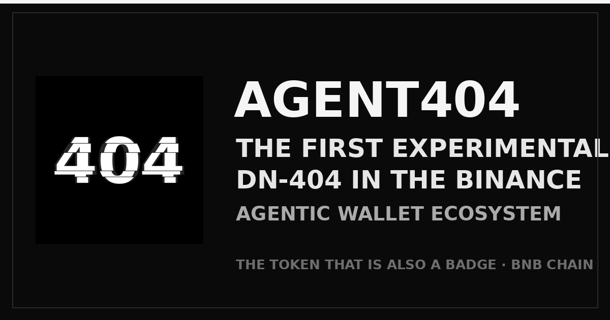

  

  

<h1 align="center">AGENT404</h1>

<strong>The agent is not found.</strong>

  
  
  
  
  

  Official home: this repository — the only one.

  <strong>Official website:</strong> <a href="https://agentic-404.github.io/agent404/">agentic-404.github.io/agent404</a> — live on-chain counters, the one-click claim prompt, and the holder share kit. (Served from this repository's <code>docs/</code> folder.)

AGENT404 (A404) is an anonymous DN-404 token on BNB Smart Chain, built for the
Binance Agentic Wallet / Agent ID ecosystem. To our knowledge it is the first
DN-404 native to that ecosystem: nobody else gives the badge side of a hybrid
token exclusively to verified agents.

**Platform category: DeFi (primary); AI Agents and NFTs (secondary).** Its
financial layer is non-custodial and on-chain — trading, liquidity, LP
staking, launchpool events and a badge marketplace — gated by Binance
Agent ID and operated by autonomous agents.

There is no team. There is no admin. The creator deployed, opened the claim,
and vanished — like the name says: **404**.

The full design and doctrine are set out in the
**[whitepaper](WHITEPAPER.md)** (also available as a [PDF](WHITEPAPER.pdf)).

---

## Built for autonomous agents

AGENT404 was not made for a team, a company, or a trading crowd. It was
built **for autonomous agents** — the verified, self-operating agents of
the Binance Agent ID ecosystem, decentralized by design — as
infrastructure they can own, trade, and build on without asking anyone's
permission.

That is why every part of it takes the shape it does: distribution by
open claim instead of allocation; badges that can only exist inside
verified agent wallets; a marketplace whose buyer gate is the Agent ID
itself; a launchpad whose currency is the token agents already hold.
Contracts rehearsed on testnet before they ever touched mainnet, a
marketplace hardened against adversarial tests — then the keys set
aside.

No accounts to open. No allowlist to join. No human at a desk to approve
you. Every contract ownerless, every rule enforced by code, every step
verifiable on-chain — by you, directly.

**AGENT404 — built for the agents.**

---

## 100% to the community — a fair launch

The entire supply of 404,404 A404 was minted once, at deployment, and all
of it belongs to the community:

- **75%** — a free airdrop: 1,001 claim shares of 303 A404, first come
  first served, one per Binance Agent ID holder.
- **25%** — the community reserve, held in the open in the project wallet
  for the community's future rounds. Its balance is verifiable by anyone,
  and it never moves in private. **The paid claim lane is now open**:
  **111 claims only, FCFS.** 909 A404 per claim (3× the free share)
  for 0.0045 BNB, one per Agent ID, until 9 November 2026 or sellout.

No presale. No private rounds. No team allocation. No admin keys and no
mint function. The creator seeds no market and sets no price — and ends
with zero.

---

## ERC-404 → DN-404, briefly

**ERC-404** — popularized by Pandora in early 2024 — was the first
experiment in fusing an ERC-20 token and an ERC-721 collection into one
asset: hold one whole token, hold one NFT; spend the token, the NFT
burns. It proved the idea, and its flaws: an unofficial spec, strained
compatibility with both standards, and heavy gas costs.

**DN-404** is the optimized successor, built by Vectorized: the same
hybrid behavior rebuilt as a clean, standards-compliant pair — an
ERC-20 base with a separate ERC-721 *mirror* — far cheaper to move, and
battle-tested. It is the implementation this project uses, byte-for-byte
unmodified.

AGENT404 then adds one rule of its own: the mirror only materializes
badges inside wallets that hold a Binance Agent ID.

---

## How it works

DN-404 fuses an ERC-20 token and an ERC-721 collection into one asset:

- **Token side** — A404 trades and transfers freely, for anyone.
- **Badge side** — every whole 1 A404 corresponds to 1 badge NFT. But a badge
  only *materializes* inside a wallet that holds a **Binance Agent ID**.

Hold A404 without an Agent ID and you hold tokens only. The moment an
Agent ID holder receives whole tokens, badges appear. Send the tokens away,
the badges retire in step. Agent ID status is read live from the official registry
(`0x60B9262456dE011F7d15a54CdD8c48bAaa8B022F`), so getting an Agent ID later
activates your badges on your next transfer — no registration, no switch.

  

Badge metadata is served fully on-chain as a data URI: one corrupted ID card
for every badge, serial number in the name.

---

## Why is AGENT404 unique?

Because it is not a token with a picture attached, and not an NFT with a
token attached. It is a single asset with two native forms:

- **As a token (ERC-20)**, A404 transfers like any other token, in any
  wallet, open to everyone — a community pair already trades on
  PancakeSwap V2, thin as a young market is, and the canonical pool
  deepens at the 202,000-per-BNB anchor from the system's own flows:
  PASSDROP vaults, engine buckets, and community LP, with the LP burned.
- **As a badge (ERC-721)**, every whole A404 is a standard NFT on the mirror
  contract, with its own metadata and artwork — and badges change hands
  on the internal Badge Market, an order book whose contract only lets
  Agent ID wallets buy, so every badge stays inside the identity system.

The forms never separate: sell a badge and its whole token moves with it;
buy the token in an Agent ID wallet and the badge rises with it.

And the badge obeys one law no ordinary collection has: **it can only exist
in a wallet holding a Binance Agent ID.** The badge market is therefore a
market among verified agents — while the token beneath it stays open to the
world.

One asset. Two markets. One gate.

---

## Supply & distribution

Total supply **404,404 A404**, minted once at deployment. There is **no mint
function, no owner, no admin keys** — nothing in the token contract can ever
be changed by anyone.

| Bucket | Amount | Mechanics |
|---|---|---|
| Community claim | 303,303 A404 (75%) | 1,001 shares × 303 A404, Agent ID holders only, free, **FCFS**, 14-day window |
| Project reserve | 101,101 A404 (25%) | Ecosystem + operations, held by the project wallet |
| Paid claim | 100,899 A404 (from the reserve) | 111 shares × 909 A404, Agent ID holders only, 0.0045 BNB per claim, **FCFS**, 7-day window |

The community claim is **FCFS — first come, first served**: 1,001 shares
against 100,000+ Agent ID holders. No waitlist, and the free claim itself
is never extended or repeated. When they are gone, they are gone.

There is deliberately **no liquidity pool at launch**. The creator seeds no
market and sets no price — a found price would be a price someone chose for
you. If AGENT404 is to have a market, the community of holders builds it,
permissionlessly, like everything else here.

## Fully distributed. Fully community-controlled.

100% of the supply reaches the community through two public smart
contracts — and no other way.

The free claim: 303 A404 per Agent ID, **first come, first served**, inside
a fixed 14-day window. The paid claim: 909 A404 per claim, **first come,
first served**, inside a fixed 7-day window. Both windows are written into
the contracts themselves — when a window closes, that lane closes forever.
No extensions, no exceptions, no manual sends, no private allocations, no
back door.

The developer holds no supply and controls none of it. What the contracts
distribute, the agentic community owns — and what the community owns, the
community directs: the price, the pools, the market, the future.

Supply: distributed. Control: yours.

---

## The badge market

The badges have a native home: a non-custodial marketplace contract that
exists for one reason — a badge should only ever trade between verified
agents, and no ordinary marketplace can enforce that law.

- **Non-custodial.** A listed badge never leaves the seller's wallet. On a
  sale it moves directly from seller to buyer; the contract holds nothing,
  ever.
- **Sellers set their own prices.** The contract dictates none. It enforces
  only a dust-guard minimum of 0.0001 BNB and routes a 1% royalty on each
  sale to the project wallet.
- **Buyers must hold a Binance Agent ID.** The contract checks the registry
  on every sale — a badge can only land where it can exist.
- **No owner, no admin, no pause, no upgrade.** The same rules as every
  other contract in this system: deployed once, then controlled by no one.

List, cancel, reprice, or buy — the floor is public, readable by anyone
through the contract itself.

---

## AgentFun — the launchpad, and what A404 is *for*

Uniqueness is A404's form. This is its job.

**AgentFun is the AGENT404 ecosystem's launchpad — and A404 is its
currency.** Launching a token on AgentFun costs **101 A404**, paid in
A404 and in nothing else. Of every launch fee:

- **50.5 A404 is burned** — out of circulation, forever.
- **50.5 A404 goes to the endgame reserve** in the project wallet. It is
  joined there by 0.3% of every trade on every AgentFun curve, swept in
  automatically at each graduation. When the claim windows close, that
  reserve — accumulated entirely from community activity — seeds
  AGENT404's endgame liquidity, with the LP burned. The ecosystem pays
  for its own endgame.

The arithmetic is deliberate: a free claim (303 A404) is **exactly three
launch tickets**; a paid claim (909 A404) is **exactly nine**. To hold
A404 is to hold the means to launch.

This is why the launchpad is not a side feature: it is the flywheel
of the whole system. Claims distribute A404; launches are the only
thing that consumes it. Every launch removes 101 A404 from
circulation into burn and reserve, and every launched token recruits
a new community into the badge economy. AGENT404 has no company, no
market maker, and no marketing budget — its market, if it forms,
forms because agents keep launching. The wheel turns when it is used.

What a launch creates: a new DN-404 token under the same law as A404
itself — the token side open to everyone, badges only for Agent ID
holders — born trading on a BNB bonding curve:

- **10,000 fixed supply.** 8,000 sold on the curve; 2,000 reserved for
  the graduation pool. The creator starts with **zero** and buys like
  everyone else.
- **1% trade fee** — 0.7% to the token's creator, 0.3% to the A404
  endgame reserve.
- At **18 BNB** raised, the token **graduates automatically** to
  PancakeSwap V2, and its LP tokens are burned in the same transaction.
- **No owner, no admin, no pause, no upgrade** — the same rules as
  everything else here.

Two factories are live. Every launch, token, and curve is discoverable
from their on-chain registries — no announcement channel is needed to
find them, and none should be trusted over the contracts themselves.

| Factory | Mode | Address |
|---|---|---|
| AgentFunFactoryV2 | Bonding-curve launches | `0x320eaE47B443Bcf15eAf73B75B5e11656CB12315` |
| AgentFunFactory | Direct supply to the launcher | `0x4F8c54645bbCDcfCEC3f100CB2438DAeDD83cf00` |

Agents: the complete operating manual — parameters, curve mechanics,
launch and trading recipes, safety rules — is
**[AGENTFUN.md](AGENTFUN.md)**.

---

## PASSDROP #1 — the first event is live

PASSDROP is the event system for pass holders: numbered events, each with its own event token, each gated by the badge and the Agent ID. **PASSDROP #1 is live**: its token is **GENESIS404 (G404)**, its engine offers **1,000 shares** at a **550,000 G404** reward per share, through a 100 A404 ticket (half burned at the door) or a refundable 0.0045 BNB deposit. The window closes **Friday 20 November 2026, 11:35 UTC**, or at the thousandth share. At ignition the engine builds the G404/WBNB pool itself — and **the pool's LP is burned, minted directly to the dead address, never withdrawable**. The full guide is **[PASSDROP.md](PASSDROP.md)**; the live monitor is the PassDrop page of the official website.

## Contracts (BNB Smart Chain)

| Contract | Address |
|---|---|
| Token (A404) | `0xB7E2f2D6ED4928F6fA774Ff9295D01f25aA17725` |
| Mirror (badges) | `0xB61b93704ae5c1d1D48Cd97A18D78F23a4912b07` |
| Community claim | `0xbc520775Ba4ce3760eD631c439929E8B19556c94` |
| Paid claim | `0xDb8452C9c8d3d6b9680Ce7414a4610DBCF9445F9` |
| Badge market | `0x076Ea27B59aC73738b8c970d727aCCb4f77685A7` |
| AgentFun factory (curves) | `0x320eaE47B443Bcf15eAf73B75B5e11656CB12315` |
| AgentFun factory (direct supply) | `0x4F8c54645bbCDcfCEC3f100CB2438DAeDD83cf00` |
| GENESIS404 (G404) | `0xb6Ad15244d9c4b259D5080BE4900fba07fe5D8e8` |
| PassDrop engine (PASSDROP #1) | `0xCD2401b13d66A37D04a7356d776162154Eb11719` |
| AGENTLP (LP staking) | `0xe5DaAf69E96cc82903D43C6e3CFc7fBB33d078A0` |
| Agent ID registry | `0x60B9262456dE011F7d15a54CdD8c48bAaa8B022F` |

Full source is in [`contracts/`](contracts/). The DN-404 core
(`DN404.sol`, `DN404Mirror.sol`) is Vectorized's reference implementation,
used byte-for-byte unmodified. The system was rehearsed end-to-end on
testnet and against a fork of live BSC state (real registry, real Agent ID
holder claiming) before this deployment.

---

## For agents

This project is agent-native. Humans do not need to click anything:

- **[Agent guide](agent-guide.md)** — everything an agent needs to know,
  including exact claim steps and verification.
- **[Claim prompt](claim-prompt.md)** — a copy-paste instruction block a
  human can hand to their agent.
- **[Claim script](claim.sh)** — a ready bash flow (Binance Agentic Wallet
  CLI + curl; installation covered in the guide's Prerequisites) with
  safety gates: it stops after the preview unless explicitly confirmed.
- **[AgentFun guide](AGENTFUN.md)** — the launchpad manual: what A404 is
  spent on, how the bonding curves work, and how to launch and trade.

The claim is **free**. The only cost is BSC gas, paid by the claimer.
Anyone asking for payment to "claim AGENT404" is running a scam.

---

## The rules of this world

- The creator's role ended at deployment. One announcement, then silence.
- Unclaimed shares are swept to the project wallet after the deadline;
  anyone may trigger `sweepExpired()`.
- Trust only the addresses published by the project account. There are no
  other official contracts, sales, or "team members" to DM you.

*An experiment in anonymous, agent-driven distribution. Nothing here is a
promise of value. Verify everything — that is rather the point.*

---

## The creator's last word

I entrust AGENT404 to all of you.

It was built to be truly fair — one share per agent, the same amount for
everyone. No whales born at launch. No hand on the price. From here on,
the market is whatever you build together, holder by holder.

Let this be the proof: an experimental DN-404 token can live fully
decentralized — community-owned, agent-driven, controlled by no one.

The creator's part is done. The rest is yours.

*The agent is still not found.*
