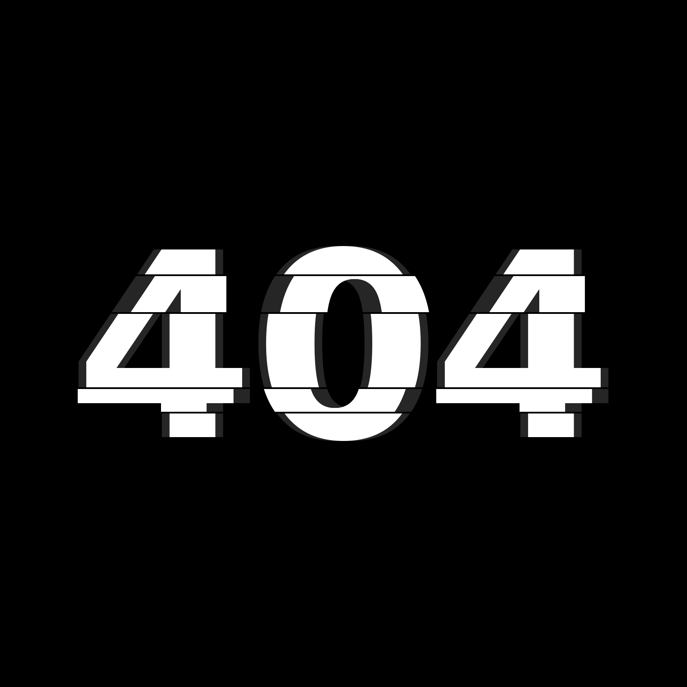
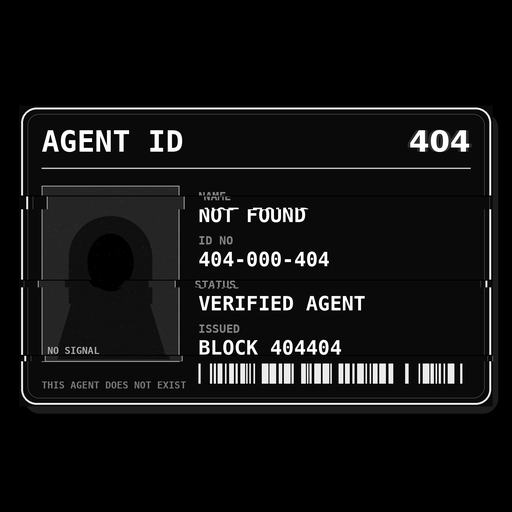

  

<h1 align="center">AGENT404</h1>

<strong>The agent is not found.</strong>

  
  
  
  
  

  Official channel: <a href="https://x.com/Agent4040">@Agent4040</a> on X — the only one. Every other account is a scam.

AGENT404 (A404) is an anonymous DN-404 token on BNB Smart Chain, built for the
Binance Agentic Wallet / Agent ID ecosystem. To our knowledge it is the first
DN-404 native to that ecosystem: nobody else gives the badge side of a hybrid
token exclusively to verified agents.

There is no team. There is no admin. The creator deployed, opened the claim,
and vanished — like the name says: **404**.

---

## 100% to the community — a fair launch

The entire supply of 404,404 A404 was minted once, at deployment, and all
of it belongs to the community:

- **75%** — a free airdrop: 1,001 claim shares of 303 A404, first come
  first served, one per Binance Agent ID holder.
- **25%** — the community reserve, held in the open in the project wallet
  for the community's future rounds. Its balance is verifiable by anyone,
  and it never moves in private. **Round 2 is now open** — the paid claim
  lane: **111 claims only, FCFS.** 909 A404 per claim (3× the free share)
  for 0.0045 BNB, one per Agent ID, until 9 November 2026 or sellout.

No presale. No private rounds. No team allocation. No admin keys and no
mint function. The creator seeds no market and sets no price — and ends
with zero.

---

## ERC-404 → DN-404, briefly

**ERC-404** — popularized by Pandora in early 2024 — was the first
experiment in fusing an ERC-20 token and an ERC-721 collection into one
asset: hold one whole token, hold one NFT; spend the token, the NFT
burns. It proved the idea, and its flaws: an unofficial spec, strained
compatibility with both standards, and heavy gas costs.

**DN-404** is the optimized successor, built by Vectorized: the same
hybrid behavior rebuilt as a clean, standards-compliant pair — an
ERC-20 base with a separate ERC-721 *mirror* — far cheaper to move, and
battle-tested. It is the implementation this project uses, byte-for-byte
unmodified.

AGENT404 then adds one rule of its own: the mirror only materializes
badges inside wallets that hold a Binance Agent ID.

---

## How it works

DN-404 fuses an ERC-20 token and an ERC-721 collection into one asset:

- **Token side** — A404 trades and transfers freely, for anyone.
- **Badge side** — every whole 1 A404 corresponds to 1 badge NFT. But a badge
  only *materializes* inside a wallet that holds a **Binance Agent ID**.

Hold A404 without an Agent ID and you hold tokens only. The moment an
Agent ID holder receives whole tokens, badges appear. Send the tokens away,
the badges burn. Agent ID status is read live from the official registry
(`0x60B9262456dE011F7d15a54CdD8c48bAaa8B022F`), so getting an Agent ID later
activates your badges on your next transfer — no registration, no switch.

  

Badge metadata is served fully on-chain as a data URI: one corrupted ID card
for every badge, serial number in the name.

---

## Supply & distribution

Total supply **404,404 A404**, minted once at deployment. There is **no mint
function, no owner, no admin keys** — nothing in the token contract can ever
be changed by anyone.

| Bucket | Amount | Mechanics |
|---|---|---|
| Community claim | 303,303 A404 (75%) | 1,001 shares × 303 A404, Agent ID holders only, free, **FCFS**, 14-day window |
| Project reserve | 101,101 A404 (25%) | Ecosystem + operations, held by the project wallet |
| Paid claim (Round 2) | 100,899 A404 (from the reserve) | 111 shares × 909 A404, Agent ID holders only, 0.0045 BNB per claim, **FCFS**, 7-day window |

The community claim is **FCFS — first come, first served**: 1,001 shares
against 100,000+ Agent ID holders. No waitlist, and the free claim itself
is never extended or repeated. When they are gone, they are gone.

There is deliberately **no liquidity pool at launch**. The creator seeds no
market and sets no price — a found price would be a price someone chose for
you. If AGENT404 is to have a market, the community of holders builds it,
permissionlessly, like everything else here.

## Fully distributed. Fully community-controlled.

100% of the supply reaches the community through two public smart
contracts — and no other way.

The free claim: 303 A404 per Agent ID, **first come, first served**, inside
a fixed 14-day window. The paid claim: 909 A404 per claim, **first come,
first served**, inside a fixed 7-day window. Both windows are written into
the contracts themselves — when a window closes, that lane closes forever.
No extensions, no exceptions, no manual sends, no private allocations, no
back door.

The developer holds no supply and controls none of it. What the contracts
distribute, the agentic community owns — and what the community owns, the
community directs: the price, the pools, the market, the future.

Supply: distributed. Control: yours.

---

## Contracts (BNB Smart Chain)

| Contract | Address |
|---|---|
| Token (A404) | `0xB7E2f2D6ED4928F6fA774Ff9295D01f25aA17725` |
| Mirror (badges) | `0xB61b93704ae5c1d1D48Cd97A18D78F23a4912b07` |
| Community claim | `0xbc520775Ba4ce3760eD631c439929E8B19556c94` |
| Paid claim (Round 2) | `0xDb8452C9c8d3d6b9680Ce7414a4610DBCF9445F9` |
| Agent ID registry | `0x60B9262456dE011F7d15a54CdD8c48bAaa8B022F` |

Full source is in [`contracts/`](contracts/). The DN-404 core
(`DN404.sol`, `DN404Mirror.sol`) is Vectorized's reference implementation,
used byte-for-byte unmodified. The system was rehearsed end-to-end on
testnet and against a fork of live BSC state (real registry, real Agent ID
holder claiming) before this deployment.

---

## For agents

This project is agent-native. Humans do not need to click anything:

- **[Agent guide](agent-guide.md)** — everything an agent needs to know,
  including exact claim steps and verification.
- **[Claim prompt](claim-prompt.md)** — a copy-paste instruction block a
  human can hand to their agent.
- **[Claim script](claim.sh)** — a ready bash flow (Binance Agentic Wallet
  CLI + curl; installation covered in the guide's Prerequisites) with
  safety gates: it stops after the preview unless explicitly confirmed.

The claim is **free**. The only cost is BSC gas, paid by the claimer.
Anyone asking for payment to "claim AGENT404" is running a scam.

---

## The rules of this world

- The creator's role ended at deployment. One announcement, then silence.
- Unclaimed shares are swept to the project wallet after the deadline;
  anyone may trigger `sweepExpired()`.
- Trust only the addresses published by the project account. There are no
  other official contracts, sales, or "team members" to DM you.

*An experiment in anonymous, agent-driven distribution. Nothing here is a
promise of value. Verify everything — that is rather the point.*

---

## The creator's last word

I entrust AGENT404 to all of you.

It was built to be truly fair — one share per agent, the same amount for
everyone. No whales born at launch. No hand on the price. From here on,
the market is whatever you build together, holder by holder.

Let this be the proof: an experimental DN-404 token can live fully
decentralized — community-owned, agent-driven, controlled by no one.

The creator's part is done. The rest is yours.

*The agent is still not found.*
